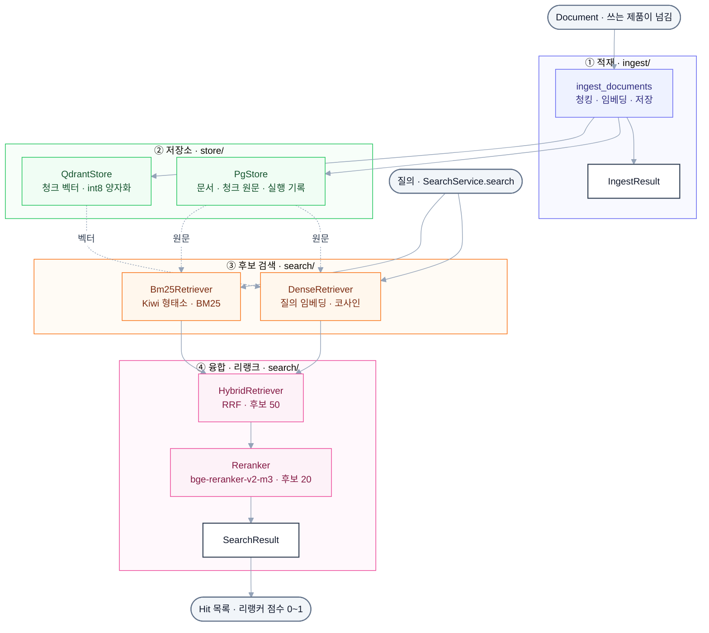

# llm-playground-retrieval

llm-playground 제품들이 함께 쓰는 검색 엔진 모듈입니다. 질의를 받아 BM25(Kiwi)와 Dense(Qdrant) 결과를 RRF로 합치고 리랭커로 다시 매겨 관련 청크를 돌려주며, 문서를 청킹 · 임베딩해 PostgreSQL · Qdrant에 넣는 인제스트 흐름도 함께 제공합니다. 패키지 이름은 `playground_retrieval`이고, 한국어 위키 QA([llm-playground-wiki](https://github.com/calm-sea-psy/llm-playground-wiki))에서 만들고 평가한 검색 부분을 떼어 냈습니다.

문서 · 청크 타입, 청커, 임베딩은 [llm-playground-corpus](https://github.com/calm-sea-psy/llm-playground-corpus)를 씁니다. 검색기는 저장소를 Protocol로 받으므로 Qdrant 대신 FAISS 색인, PG 대신 메모리 저장소를 끼울 수 있습니다.

## 전체 흐름



## 폴더 구조

```
llm-playground-retrieval/
├─ src/playground_retrieval/
│  ├─ core/         검색 결과 · 범위 자료형(Hit · Filters · VectorHit) · 계약(Retriever)
│  ├─ store/        PostgreSQL(문서 · 청크 원문 · 실행 기록) · Qdrant(청크 벡터, int8 양자화)
│  ├─ search/       BM25(Kiwi, 색인 저장 · 불러오기) · Dense · Hybrid(RRF) · Reranker · FAISS 색인 · SearchService
│  ├─ ingest/       ingest_documents — 문서 → 청킹 → 임베딩(npy 캐시) → PG · Qdrant → 실행 기록
│  └─ eval/         ANN 벤치 지표(recall@k · 지연 분위수) · recall–QPS 그래프
├─ bench/
│  ├─ bench_ann.py  ANN 벤치 (FAISS · Qdrant)
│  └─ data/         FAISS 결과 체크포인트 (git 제외)
├─ tests/           단위 · 연동 테스트. test_layers.py가 하위 패키지 의존 방향을 검사
├─ .ruff/           공유 ruff 설정 복사본 (직접 고치지 않음)
├─ pyproject.toml   의존성 · extras (uv)
└─ ruff.toml        ruff 설정
```

## 기술 스택

| 구분 | 사용 |
| --- | --- |
| 언어 · 환경 | Python 3.13 이상, uv |
| 키워드 검색 | BM25 (`.npy` 역색인 직접 구현), kiwipiepy (Kiwi 형태소) |
| 벡터 검색 | Qdrant (qdrant-client, HNSW · int8 스칼라 양자화), FAISS (faiss-cpu, ANN 벤치용 — 서빙은 Qdrant) |
| 융합 · 리랭크 | RRF, sentence-transformers CrossEncoder — BAAI/bge-reranker-v2-m3 (`[rerank]` extras) |
| 저장소 | PostgreSQL (psycopg) |
| 코퍼스 | `playground-corpus` `v0.1.0` (git 태그) |
| 벤치 지표 | `playground_evalkit` (`bench` 그룹, git 태그로 설치) |

## 빠르게 실행해 보기

[uv](https://docs.astral.sh/uv/)를 설치한 상태에서 시작합니다. 저장소를 쓰는 3단계에만 [Docker](https://docs.docker.com/get-docker/)가 필요합니다.

### 1. 패키지 설치

```bash
uv sync --all-extras
```

`--all-extras`는 리랭커 · 임베딩 모델 실행에 필요한 torch(개발 환경은 CUDA 12.8 빌드) · sentence-transformers까지 설치합니다.

### 2. 저장소 없이 검색해 보기

```bash
uv run python -c "
from playground_corpus import Chunk
from playground_retrieval.search import Bm25Retriever, HybridRetriever, KiwiAnalyzer
chunks = [
    Chunk('1-0', '1', '조선', '', '조선\n조선의 수도는 한양이다.', 0, 8),
    Chunk('2-0', '2', '고려', '', '고려\n고려의 수도는 개경이다.', 0, 8),
    Chunk('3-0', '3', '신라', '', '신라\n신라의 수도는 금성이다.', 0, 8),
]
bm25 = Bm25Retriever.from_chunks(chunks, KiwiAnalyzer.load())
for hit in HybridRetriever([bm25]).search('조선의 수도는?', k=2):
    print(hit.chunk.id, round(hit.score, 4), hit.chunk.title)
"
```

`Bm25Retriever.from_chunks`는 색인과 원문을 메모리에 둡니다. `1-0 0.0164 조선`이 첫 줄에 나오면 성공입니다 (점수는 RRF `1 / (60 + 순위)`).

### 3. (선택) 저장소와 함께 쓰기

PostgreSQL · Qdrant는 llm-playground-wiki의 `docker-compose.yml`을 함께 씁니다 (같은 이미지 · 계정, localhost:5432 · 6333). 위키를 같은 부모 폴더에 나란히 clone 해 둡니다.

```bash
docker compose -f ../llm-playground-wiki/docker-compose.yml up -d --wait
```

저장소 두 개를 띄우고 헬스체크 통과까지 기다립니다. 컬렉션 적재 · 검색은 아래 [사용법](#사용법)의 예시를 따릅니다.

## 설정

`PgConfig.from_env()` · `QdrantConfig.from_env()`가 읽는 값입니다. 이 레포에는 `.env` 견본이 없고, 쓰는 제품이 넘깁니다 (`uv run --env-file …`).

| 항목 | 변수 | 값 | 없으면 |
| --- | --- | --- | --- |
| Qdrant 모드 | `QDRANT_MODE` | `local` · `cloud` | `local` — 로컬 Qdrant(`http://localhost:6333`) |
| Qdrant Cloud 주소 | `QDRANT_URL` | `QDRANT_MODE=cloud`일 때만 읽음 | cloud인데 비면 `ValueError` |
| Qdrant Cloud 키 | `QDRANT_API_KEY` | `QDRANT_MODE=cloud`일 때만 읽음 | 키 없이 접속 |
| Qdrant 프로토콜 | `QDRANT_GRPC` | `0`이면 REST | gRPC |
| Qdrant 시간 제한 | `QDRANT_TIMEOUT` | 초 | 클라이언트 기본 5초 |
| PostgreSQL 접속 | `POSTGRES_HOST` · `POSTGRES_PORT` | | `localhost` · `5432` |
| PostgreSQL 계정 | `POSTGRES_USER` · `POSTGRES_PASSWORD` · `POSTGRES_DB` | | 모두 `rag` |

주소 · 키가 환경에 있어도 `QDRANT_MODE=cloud`를 켜지 않으면 로컬 Qdrant에 붙습니다.

## 사용법

### 설치

```bash
# 기본 — 검색기 · 저장소 · 인제스트 흐름
uv add "playground-retrieval @ git+https://github.com/calm-sea-psy/llm-playground-retrieval@v0.3.0"

# 리랭커 · 임베딩 모델 실행 (torch, sentence-transformers)
uv add "playground-retrieval[rerank] @ git+https://github.com/calm-sea-psy/llm-playground-retrieval@v0.3.0"
```

0.x 동안은 깨는 변경이 있을 수 있습니다. 이 레포와 함께 고칠 때는 같은 부모 폴더에 나란히 clone 하고 잠깐 path로 바꿔 씁니다.

### 검색

llm-playground-wiki가 적재한 컬렉션을 Hybrid → 리랭커로 찾는 예시입니다. PG · Qdrant와 BM25 색인(`scripts/build_bm25.py`로 저장)이 있어야 합니다.

```python
from pathlib import Path

from playground_corpus import EMBEDDING_MODELS, SentenceTransformerEmbedder
from playground_retrieval.search import (
    Bm25Index,
    Bm25Retriever,
    CrossEncoderScorer,
    DenseRetriever,
    HybridRetriever,
    KiwiAnalyzer,
    Reranker,
)
from playground_retrieval.store import PgConfig, PgStore, QdrantStore

collection = "kowiki-subset-10000_kure-v1"
embedder = SentenceTransformerEmbedder.load(EMBEDDING_MODELS["kure-v1"])

with PgStore.connect(PgConfig.from_env()) as pg:
    dense = DenseRetriever(
        embedder, QdrantStore.from_env(), pg, collection=collection, source="kowiki"
    )
    bm25 = Bm25Retriever(
        Bm25Index.load(Path("data/index/bm25") / collection),
        KiwiAnalyzer.load(),
        pg,
        collection=collection,
        source="kowiki",
    )
    reranker = Reranker(HybridRetriever([dense, bm25]), CrossEncoderScorer.load())
    for hit in reranker.search("조선의 수도는?", k=5):
        print(round(hit.score, 3), hit.chunk.title, hit.chunk.section)
```

### 주요 API

| 함수 · 클래스 | 역할 | 비고 |
| --- | --- | --- |
| `Retriever` | `search(query, k, filters)` 계약 (Protocol) | Dense · BM25 · Hybrid · Reranker가 모두 채움 |
| `Hit(chunk, score)` · `VectorHit` · `Filters(doc_ids, categories)` | 검색 결과 · 범위 | 점수 척도는 검색기마다 다름 (코사인 · BM25 원점수 · 리랭커 0~1) |
| `PgStore.connect(PgConfig.from_env())` | 문서 · 청크 원문 · 실행 기록 | `with`로 씀. 스키마는 `create_schema()` |
| `QdrantStore.from_env()` | 청크 벡터 + 필터용 payload | 코사인 · int8 양자화(RAM) · 원본 벡터 on_disk. 본문은 넣지 않음 |
| `KiwiAnalyzer.load()` | BM25 형태소 분석기 | Kiwi 하나가 약 500MB — 같은 프로세스면 `KiwiAnalyzer(kiwi)`로 공유 |
| `Bm25Index.build(chunks, analyzer)` · `load(directory)` · `save(directory)` | BM25 역색인 | `.npy`를 메모리 매핑으로 읽음 |
| `Bm25Retriever(index, analyzer, store, collection=, source=)` | 키워드 검색기 | `from_chunks(chunks, analyzer)`는 메모리 전용 |
| `DenseRetriever(embedder, index, store, collection=, source=)` | 벡터 검색기 | `index`는 `QdrantStore` · `FaissIndex` |
| `HybridRetriever(retrievers, rrf_k=60, candidates=50)` | RRF 융합 | 순위만 합쳐 점수 정규화가 필요 없음 |
| `Reranker(base, scorer, candidates=20)` | 후보를 다시 매김 | 점수는 쌍마다 독립인 0~1이라 질의끼리 비교 가능 |
| `CrossEncoderScorer.load(model_id=…)` | `PairScorer` 구현 (기본 BAAI/bge-reranker-v2-m3) | `[rerank]` extras. 잘리는 쌍은 경고 |
| `FaissIndex.build(vectors, chunk_ids, doc_ids, collection=, factory=)` | FAISS 색인 | `VectorIndex` 계약을 채움. ANN 벤치용 |
| `SearchService.build(settings, pg, qdrant)` · `SearchSettings` · `SearchResult` | Hybrid + Reranker 조립 · 질의 직렬 실행 | `await service.search(query, k, filters)` |
| `ingest_documents(documents, source=, collection=, chunker=, embedder=, cache=, pg=, qdrant=)` | 적재 → `IngestResult` | 같은 키는 덮어써서 중단 뒤 다시 돌려도 됨 |
| `recall_at_k` · `latency_summary` · `recall_qps_svg` | ANN 벤치 지표 · 그래프 | `playground_retrieval.eval` |

의존 방향은 `core ← store · search · eval`, `core · store ← ingest`입니다. `search`는 저장소 구현을 직접 import하지 않고 Protocol(`ChunkStore` · `VectorIndex`)로 받습니다.

## 명령어

ANN 벤치(`bench/bench_ann.py`)입니다. FAISS(Flat · HNSW · IVF · IVF+SQ8 · IVF+PQ)와 Qdrant(HNSW float · int8 · int8+rescore)를 recall@10 · KorQuAD hit@5 · MRR@10 · 지연 · QPS로 비교합니다. llm-playground-wiki가 적재한 컬렉션(PG · Qdrant)을 쓰고 그 레포의 임베딩 캐시 · 서브셋을 파일 경로로만 읽습니다(import 하지 않음).

| 명령 | 옵션 | 설명 |
| --- | --- | --- |
| `bench_ann.py` | `--collection` (필수) · `--wiki-root` (기본 `../llm-playground-wiki`) · `--source` (기본 `kowiki`) · `--model` (기본 `kure-v1`) · `--max-tokens` (기본 384) · `--queries` (기본 1000) · `--seed` (기본 0) · `--nlist` · `--skip-qdrant-exact` · `--qdrant-variants` · `--float-ef` · `--qdrant-batch` · `--redo-faiss` · `--run-id` | FAISS 결과는 `bench/data/runs/{run_id}/faiss.json`(git 제외)에 남겨 Qdrant 단계만 다시 돌릴 수 있고, 결과 표 · 그래프는 `reports/{run_id}.md` · `.svg`에 씀 |

```bash
uv run --group bench --extra rerank python bench/bench_ann.py --collection kowiki-subset-10000_kure-v1
```

서브셋으로 1차 확인합니다. `--extra rerank`(torch)는 질의 벡터 캐시가 없을 때 임베딩 모델을 올리는 데만 씁니다.

```bash
QDRANT_TIMEOUT=300 uv run --group bench --extra rerank python bench/bench_ann.py --collection kowiki_kure-v1 --skip-qdrant-exact --float-ef 16 32 --qdrant-batch 10 --nlist 4096 --run-id ann-benchmark
```

전체 규모 실행입니다. 100개 묶음 요청이 기본 시간 제한 5초를 넘으므로 `QDRANT_TIMEOUT`을 늘립니다.

## 테스트

```bash
uv sync --all-extras
uv run pytest
uv run ruff check
```

PG · Qdrant 연동 테스트는 서비스가 떠 있지 않으면 건너뜁니다. 띄워 두면 테스트마다 임시 스키마 · 컬렉션을 만들고 지웁니다. `tests/search/test_rerank_contract.py`는 리랭커 토크나이저를 HF 허브에서 받으므로 네트워크가 없으면 로컬에서는 건너뛰고, `CI` 환경 변수가 있으면 실패합니다. CI(`.github/workflows/ci.yml`)는 `main` push와 PR에서 PostgreSQL · Qdrant를 서비스 컨테이너로 띄워 ruff · pytest를 돌리고, `.github/workflows/pr-lint.yml`은 PR 제목 · 본문 규칙을 검사합니다.

## 실험 결과

전체 규모 결과는 위키 레포 [reports/ann-benchmark.md](https://github.com/calm-sea-psy/llm-playground-wiki/blob/main/reports/ann-benchmark.md)에 있습니다. `kowiki_kure-v1` 벡터 2,393,485개 · KorQuAD dev 질문 1,000개로 쟀고, 아래는 그 표의 일부입니다.

| 엔진 | 색인 | 설정 | recall@10 | hit@5 | p50 ms | QPS |
| --- | --- | --- | --- | --- | --- | --- |
| FAISS | Flat | - | 1.000 | 0.714 | 212.970 | 168 |
| FAISS | HNSW32 | efSearch=128 | 0.919 | 0.666 | 0.960 | 3393 |
| FAISS | IVF4096,Flat | nprobe=64 | 0.879 | 0.650 | 4.060 | 506 |
| Qdrant | HNSW float | hnsw_ef=32 | 0.926 | 0.681 | 382.400 | 2 |
| Qdrant | HNSW int8 | hnsw_ef=128 | 0.952 | 0.711 | 7.590 | 164 |
| Qdrant | HNSW int8+rescore x2 | hnsw_ef=128 | 0.986 | 0.709 | 8.390 | 167 |

Qdrant는 원본 벡터(on_disk)로 찾으면 질의당 수백 ms가 들어 int8 양자화(RAM)가 필수입니다. hit@5는 recall 0.95 부근부터 거의 늘지 않습니다.
